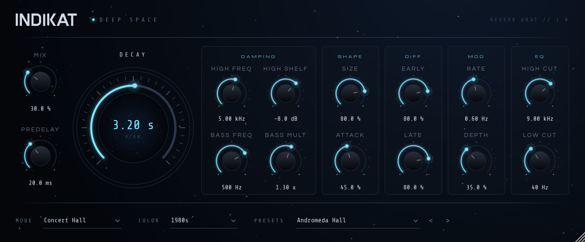

# INDIKAT Deep Space

Algorithmic reverb plugin (VST3 / AU / Standalone, JUCE 8) in the INDIKAT look.



## Download

Every push to `main` builds Windows, macOS and Linux on GitHub Actions and publishes them under
[**Releases**](../../releases/latest).

- **Windows:** unzip, copy the `.vst3` to `C:\Program Files\Common Files\VST3\`.
- **All INDIKAT plugins at once (macOS / Linux) – recommended:** open Terminal and paste once
  ```bash
  curl -fsSL https://raw.githubusercontent.com/coop030/indikat-deep-space/main/packaging/updater/indikat-update.sh | bash
  ```
  It finds every INDIKAT plugin (all `coop030/indikat-*` repos and release series), installs only what is newer
  than what you have, and on macOS puts **`INDIKAT Updater.command`** on the Desktop – from then on, double-click it to update.
  Options: `| bash -s check` (only show what's new), `| bash -s force` (reinstall all), `| bash -s pluto star-pad` (only those).
- **macOS, single plugin:** open Terminal and paste
  ```bash
  curl -fsSL https://raw.githubusercontent.com/coop030/indikat-deep-space/main/packaging/macos/install.sh | bash -s deepspace
  ```
  It downloads the latest build, installs VST3 + AU and signs them. Run it again to update.
  Other INDIKAT plugins: list them, e.g. `... | bash -s deepspace pluto starpad bass`.
- **macOS (manual):** unzip (double-click), open Terminal and run
  `bash ~/Downloads/INDIKAT-Deep-Space/INDIKAT\ installieren.command`.
  It asks for your Mac password, copies VST3 + AU to Macintosh HD › Library › Audio › Plug-Ins,
  removes the quarantine flag and signs the plugin locally.
- **Linux:** copy the `.vst3` to `~/.vst3/`.

Then rescan plugins in your DAW.

## Controls

| Group | Knobs |
|---|---|
| — | **Mix**, **Predelay** (0–500 ms) |
| **Decay** | RT60, 0.2–70 s (big dial) |
| **Damping** | High Freq + High Shelf (highs decay faster: −24 dB = 1/10 of Decay), Bass Freq + Bass Mult (bass decays longer or shorter) |
| **Shape** | Size (room size), Attack (how slowly the tail builds) |
| **Diff** | Early (input smear), Late (density of the tail) |
| **Mod** | Rate, Depth (chorus inside the tank) |
| **EQ** | High Cut, Low Cut on the wet signal |

Footer: **Mode** (17 algorithms: Concert Hall, Bright Hall, Plate, Room, Chamber, Random Space, Chorus Space, Ambience,
Sanctuary, Dirty Hall, Dirty Plate, Smooth Plate, Smooth Room, Smooth Random, Nonlin, Chaotic Hall, Chaotic Chamber),
**Color** (1970s: dark, grainy, wobbly / 1980s: clean, slightly dark / Now: full bandwidth), 20 **Presets** with `<` / `>`.

Drag = change value, **double-click** = default, mouse wheel works. The window scales freely (bottom-right corner).

## How it works

`Source/DeepSpaceReverb.cpp`, no external DSP libraries:

- Predelay, Color bandwidth (and 12-bit converter grain in 1970s), early reflections (Room / Chamber / Hall patterns),
  4 early-diffusion allpasses per side, attack smear and a 4-tap swell that shapes the build-up.
- Hall, room, chamber and plate modes: 16-line feedback delay network mixed by a fast Hadamard transform. Per line:
  modulated delay (sine, random walk, chorus or chaotic), 1–2 late-diffusion allpasses, high shelf + bass shelf
  computed from three decay times (Decay, highs, bass), Color low-pass. Dirty modes saturate inside the loop.
- Nonlin: 48-tap gated / reverse envelope (Attack 0 = gate, 1 = reverse) over up to 1.5 s.
- Each mode is level-matched; the tank input is scaled with the loop gain so long tails don't get louder.

Measured with `IndikatRenderTest --ir`: echo density ≈ 1.0 (noise-like) from ~60 ms in every mode,
RT60 within 5 % of Decay, no resonant peaks above the noise level in the halls, plates and rooms.

## Building

CMake ≥ 3.22 and a C++17 compiler (Windows: Visual Studio 2022, macOS: Xcode). JUCE is downloaded automatically.

```bash
cmake -B build -DCMAKE_BUILD_TYPE=Release
cmake --build build --config Release
```

Result: `build/IndikatDeepSpace_artefacts/Release/VST3/INDIKAT Deep Space.vst3` (plus AU on macOS and Standalone).

**Offline test:** `cmake -B build -DINDIKAT_TESTS=ON` builds `IndikatRenderTest`. It renders every preset as WAV and
checks for NaN, overload and that every tail decays. `--ir <dir> [param value ...]` writes the impulse response of
every mode, `--process in.wav out.wav <preset> [param value ...]` runs a file through a preset,
`--snapshot ui.png` renders the plugin window.

`web/index.html` is the original browser prototype.

## Licenses

Fonts: Michroma, Questrial, Share Tech Mono (SIL Open Font License).
JUCE: AGPLv3 or a commercial JUCE license. Selling the plugin or shipping it closed source requires a JUCE license.
