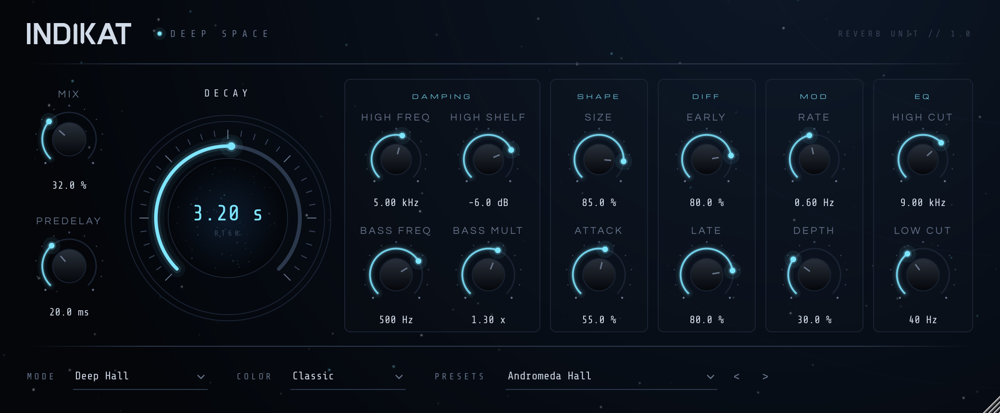

# INDIKAT Deep Space

Algorithmic reverb plugin (VST3 / AU / Standalone, JUCE 8) in the INDIKAT look.



## Download

Every push to `main` builds Windows, macOS and Linux on GitHub Actions and publishes them under
[**Releases**](../../releases/latest).

- **Windows:** unzip, copy the `.vst3` to `C:\Program Files\Common Files\VST3\`.
- **macOS:** unzip (double-click), open Terminal and run
  `bash ~/Downloads/INDIKAT-Deep-Space/INDIKAT\ installieren.command`.
  It asks for your Mac password, copies VST3 + AU to Macintosh HD › Library › Audio › Plug-Ins,
  removes the quarantine flag and signs the plugin locally.
- **Linux:** copy the `.vst3` to `~/.vst3/`.

Then rescan plugins in your DAW.

## Controls

| Group | Knobs |
|---|---|
| — | **Mix**, **Predelay** (0–500 ms) |
| **Decay** | RT60, 0.2–30 s (big dial) |
| **Damping** | High Freq + High Shelf (darkens the tail per pass), Bass Freq + Bass Mult (bass decays longer or shorter) |
| **Shape** | Size (room size), Attack (how slowly the tail builds) |
| **Diff** | Early (input smear), Late (density of the tail) |
| **Mod** | Rate, Depth (chorus inside the tank) |
| **EQ** | High Cut, Low Cut on the wet signal |

Footer: **Mode** (Deep Hall, Room, Chamber, Plate, Nebula, Ambience), **Color** (Vintage, Classic, Modern),
12 **Presets** with `<` / `>`.

Drag = change value, **double-click** = default, mouse wheel works. The window scales freely (bottom-right corner).

## How it works

`Source/DeepSpaceReverb.cpp`, no external DSP libraries:

- Predelay, then 4 allpasses per side (early diffusion) and 2 long allpasses (attack smear).
- 8-line feedback delay network mixed by a fast Hadamard transform.
- Per line: modulated delay (cubic interpolation), late allpass, high shelf, bass shelf, Color low-pass, soft limiter.
- Each line's feedback is set from the RT60, so the tail reaches −60 dB at the chosen Decay;
  the bass shelf stretches the decay below Bass Freq by Bass Mult.
- The tank input is scaled with the loop gain, so long tails don't get louder than short ones.

## Building

CMake ≥ 3.22 and a C++17 compiler (Windows: Visual Studio 2022, macOS: Xcode). JUCE is downloaded automatically.

```bash
cmake -B build -DCMAKE_BUILD_TYPE=Release
cmake --build build --config Release
```

Result: `build/IndikatDeepSpace_artefacts/Release/VST3/INDIKAT Deep Space.vst3` (plus AU on macOS and Standalone).

**Offline test:** `cmake -B build -DINDIKAT_TESTS=ON` builds `IndikatRenderTest`. It renders every preset as WAV and
checks for NaN, overload and that every tail decays. `IndikatRenderTest --snapshot ui.png` renders the plugin window.

`web/index.html` is the original browser prototype.

## Licenses

Fonts: Michroma, Questrial, Share Tech Mono (SIL Open Font License).
JUCE: AGPLv3 or a commercial JUCE license. Selling the plugin or shipping it closed source requires a JUCE license.
